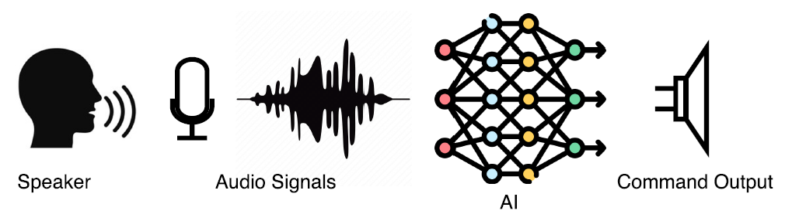
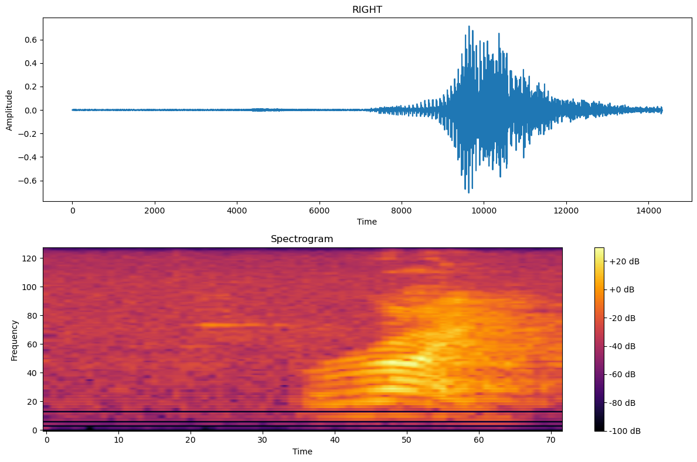
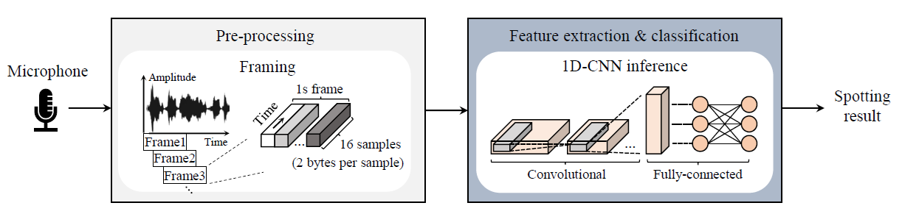
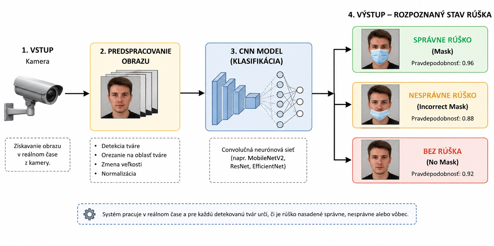
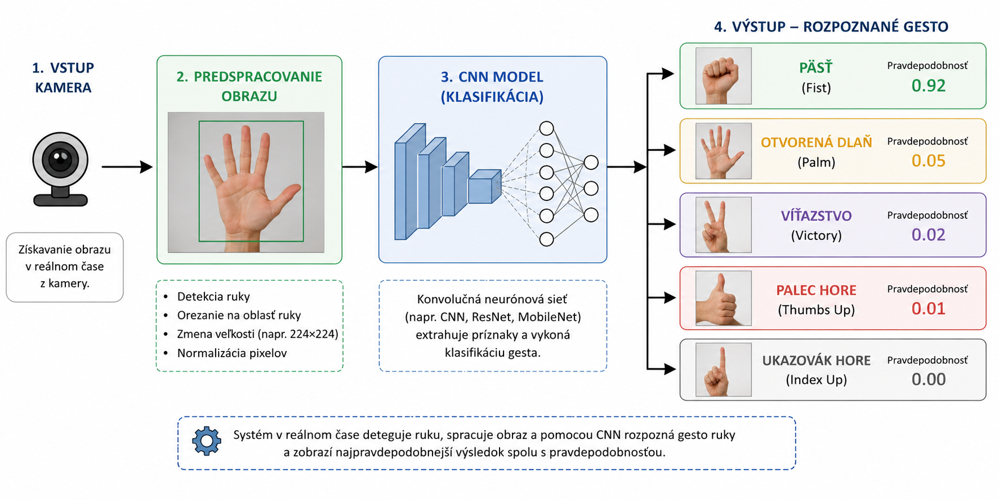
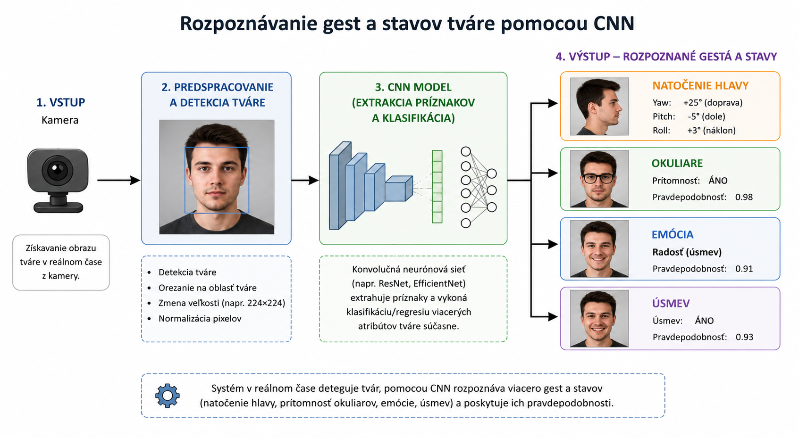

# KEGA Projekt - Laboratórium aplikovaných technológií umelej inteligencie

## Anotácia projektu
Umelá inteligencia (UI) je technológia, ktorá dokáže simulovať ľudské uvažovanie a učenie
pomocou algoritmov strojového učenia a hlbokých neurónových sietí (HNS). V dnešnej dobe sa
UI stala neoddeliteľnou súčasťou mnohých oblastí nášho života ako napr. zdravotníctvo, doprava,
priemysel, spracovanie textu, atď. V zdravotníctve sa používa napríklad na diagnostiku a predikciu
chorôb na základe analýzy obrazových a laboratórnych výsledkov. V doprave sa používa na
plánovanie trás, predikciu a minimalizáciu meškaní a optimalizáciu spotreby paliva. V priemysle sa
používa na optimalizáciu výrobných procesov a znižovanie nákladov, hodnotenie kvality produktov,
atď. Oblasť spracovania textu zahŕňa analýzu, porozumenie a generovanie textu.

Dnešné programovateľné logické automaty (PLC – programmable logic controller; PAC –
programmable automation controller) majú za sebou štyridsať rokov vývoja. Ide o priemyselné
riadiace systémy schopné riadiť a monitorovať spojité (tlaky, teploty, prietoky, ...) a diskrétne
udalostné systémy (dopravníky, roboty, ...). Trend vývoja programovacích jazykov PLC spôsobil
rozšírenie základných bitových inštrukcií o nové (matematické, komunikačné, diagnostické, riadiace,
bezpečnostné, ...). Významný posun nastal aj v oblasti výkonu procesorov (CPU) PLC. Uvedené
zmeny umožňujú nasadenie metód UI pre riadenie a monitorovanie procesov. Existujú dva prístupy
implementácie UI v PLC, implementácia v CPU alebo v externom zariadení (PC, priemyselné PC,
Edge zariadenie, cloud, ...).

## Zameranie projektu
Projekt sa zameriava na vybudovanie moderného laboratória aplikovaných technológií umelej
inteligencie pre priemysel. Laboratórium bude pozostávať z 5 rôznych pracovísk zameraných na
spracovanie obrazu, videa a zvuku pre priemyselné aplikácie. Pracoviská sú navrhnuté tak, aby mohli
byť nezávislé od operačného systému (Linux, Windows) a softvéru pre HNS (Matlab, Python, ...).
Laboratórium budú využívať študenti 3. ročníka bakalárskeho štúdia a študenti 1. a 2. ročníka
inžinierskeho štúdia na vybraných predmetoch a študenti bakalárskych, diplomových, individuálnych
a tímových prác, ale aj doktorandi. Plánujeme nasledovné pracoviská:

### Pracovisko 1.
Počítačová zostava s výkonnou grafickou kartou, kvalitná hĺbková kamera, priemyselný
riadiaci systém, model. Cieľom pracoviska bude spracovanie obrazu na kontrolu kvality objektov
(výrobkov).

### Pracovisko 2. 
Počítačová zostava s výkonnou grafickou kartou, kvalitná hĺbková kamera, priemyselný
riadiaci systém, existujúci riadiaci systém a existujúci model CNC. HMI pracovisko pre
rozpoznávanie gest, tváre, hlasových povelov pomocou hlbokých neurónových sietí.

#### Rozpoznávanie hlasových povelov pomocou hlbokých neurónových sietí.
Rozpoznávanie hlasových povelov predstavuje jednu z praktických aplikácií spracovania rečového signálu a metód umelej inteligencie. 
Cieľom je automaticky identifikovať krátke hovorené povely, napríklad „štart“, „stop“, „zapni“ alebo „dopredu“, a zaradiť ich do vopred definovaných tried. 
Takéto systémy nachádzajú uplatnenie pri hlasovom ovládaní zariadení, robotov, inteligentných domácností alebo pri interakcii človeka so strojom (HMI).

Obr.1 Principiálna schéma rozpoznávania hlasových povelov

Moderné riešenia využívajú najmä hlboké neurónové siete, ktoré dokážu z audio signálu automaticky extrahovať charakteristické príznaky a následne vykonať klasifikáciu povelu. 
Vstupný zvukový signál sa môže spracovávať priamo vo formáte RAW signálu alebo sa najskôr transformuje do vhodnej časovo-frekvenčnej reprezentácie, napríklad Mel-spektrogramu.

Obr.2 Ukážka RAW signálu a spektrogramu hlasového povelu „right“

Na klasifikáciu sa následne používajú napríklad konvolučné neurónové siete (CNN), rekurentné siete ako LSTM a GRU, kombinované modely napr. CNN+LSTM  alebo modernejšie architektúry založené na mechanizme attention.

Obr.3 Príklad rozpoznávania hlasového povelu pomocou RAW signálu a CNN s 1D konvolúciou

Úlohou je vytvoriť a overiť rôzne architektúry hlbokých neurónových sietí a ich schopnosť spoľahlivo rozpoznávať vybranú množinu hlasových povelov a vyhodnotiť ich úspešnosť a iných klasifikačných metrík na testovacích zvukových záznamoch.

Návod na trénovanie a testovanie vybraných architektúr HNS (RAW+1D-CNN, RAW+CNN-LSTM, SPECT+CNN)

[Návod_Hlasové_povely](document/guide_hlas_povely.pdf)

#### Rozpoznávanie správne nasadeného rúška pomocou hlbokých neurónových sietí.
Rozpoznávanie správne nasadeného ochranného rúška predstavuje jednu z praktických úloh počítačového videnia, pri ktorej je možné využiť metódy hlbokého učenia. 
Cieľom je na základe obrazu alebo videozáznamu automaticky detegovať osoby a následne určiť, či majú rúško nasadené správne, nesprávne alebo ho nemajú vôbec. 

Obr.4 Principiálna schéma rozpoznávania správneho nasadenia rúška

Na riešenie tejto úlohy sa využívajú najmä konvolučné neurónové siete (CNN) a moderné modely na detekciu objektov, 
napríklad rodina YOLO, ktoré umožňujú lokalizovať tvár alebo osobu v obraze a zároveň vykonať klasifikáciu spôsobu nasadenia rúška.

#### Rozpoznávanie statických gest ruky pomocou hlbokých neurónových sietí.
Rozpoznávanie gest ruky predstavuje významnú oblasť počítačového videnia, ktorá umožňuje prirodzenú a bezkontaktnú komunikáciu človeka s počítačom, robotom alebo iným technickým zariadením. 
Uplatnenie nachádza napríklad pri ovládaní robotických systémov, v inteligentných domácnostiach, automobiloch alebo pri tvorbe používateľských rozhraní. 
Cieľom je na základe obrazu z kamery automaticky detegovať ruku a následne rozpoznať (klasifikovať) ukazované gesto. 

Obr.5 Principiálna schéma rozpoznávania statických gest ruky

Na automatické rozpoznávanie gest je možné efektívne využiť konvolučné neurónové siete (CNN), ktoré dokážu priamo z obrazových dát extrahovať charakteristické príznaky a následne klasifikovať jednotlivé gestá. 
Vstupný obraz získaný kamerou sa predspracuje, lokalizuje sa oblasť ruky a následne sa pomocou CNN priradí k jednej z definovaných tried gest.

#### Rozpoznávanie gest a stavov tváre pomocou hlbokých neurónových sietí.
Rozpoznávanie gest a stavov tváre predstavuje významnú oblasť počítačového videnia zameranú na automatickú analýzu vizuálnych prejavov človeka. 
Okrem identifikácie osoby je možné z obrazu tváre určovať napríklad natočenie a polohu hlavy, prítomnosť okuliarov, otvorenie alebo zatvorenie očí a úst či základné emócie, ako sú úsmev, prekvapenie alebo smútok. 
Takéto systémy nachádzajú uplatnenie pri interakcii človeka s počítačom a robotom, monitorovaní pozornosti vodiča, asistenčných systémoch alebo inteligentných používateľských rozhraniach. 
 

Obr.6 Principiálna schéma rozpoznávania gest a stavov tváre

Na riešenie týchto úloh je možné efektívne využiť konvolučné neurónové siete (CNN). 
Po detekcii a lokalizácii tváre v obraze CNN automaticky extrahuje charakteristické vizuálne príznaky a na ich základe vykoná klasifikáciu požadovaného stavu alebo regresný odhad, napríklad uhlov natočenia hlavy. 

### Pracovisko 3.
Počítačová zostava s výkonnou grafickou kartou, kvalitná hĺbková kamera, Nvidia Jetson
(Edge zariadenie), priemyselný riadiaci systém, existujúci robot (UR). Pracovisko pre detekciu
objektov pomocou hlbokého učenia vhodné napr. pre účely bin picking, pick & place.

### Pracovisko 4. 
Počítačová zostava, kvalitná kamera, Nvidia Jetson (Edge zariadenie), priemyselný riadiaci
systém. Cieľom pracoviska bude sledovanie pohybujúcich sa objektov na videu pomocou hlbokých
neurónových sietí.

### Pracovisko 5. 
Počítačová zostava, kvalitný mikrofón, Nvidia Jetson (Edge zariadenie), priemyselný
riadiaci systém. Cieľom pracoviska bude spracovanie zvuku a odoslanie výsledku spracovania do
priemyselného riadiaceho systému s cieľom učenia kvality.